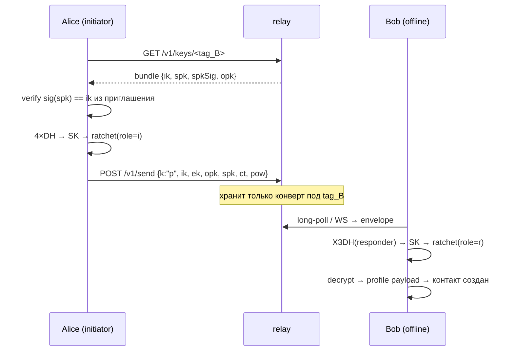

# Архитектура

## Слои

```
┌──────────────────────────────────────────────────────────────────┐
│ packages/app · React PWA                                         │
│   экраны, i18n, IndexedDB, QR, service worker                    │
└───────────────▲──────────────────────────────────────────────────┘
                │ snapshot() + события (change/message/toast)
┌───────────────┴──────────────────────────────────────────────────┐
│ packages/core · MeshChatClient (engine.ts)                       │
│   контакты · сессии · очередь · ретраи · исчезающие сообщения     │
│                                                                  │
│   ┌───────────┐  ┌──────────┐  ┌──────────────┐  ┌────────────┐  │
│   │ identity  │  │ prekeys  │  │ x3dh+ratchet │  │ protocol   │  │
│   │ Ed25519   │  │ SPK/OPK  │  │ XChaCha20    │  │ payloads   │  │
│   └───────────┘  └──────────┘  └──────────────┘  └────────────┘  │
│                                                                  │
│   ┌─────────────────────────── transports ────────────────────┐  │
│   │ relay (WS + long-poll) │ git (GitHub API) │ local (BC)    │  │
│   └───────────────────────────────────────────────────────────┘  │
└───────────────▲──────────────────────────────────────────────────┘
                │ envelope JSON (непрозрачный для транспорта)
┌───────────────┴──────────────────────────────────────────────────┐
│ packages/relay · zero-knowledge mailbox                          │
│   POST /v1/send · POST /v1/wait · GET /v1/pull · /v1/keys/:tag   │
│   WS /v1/ws · статика UI · PoW · rate limit · TTL · journal      │
└──────────────────────────────────────────────────────────────────┘
```

Ключевая граница: **транспорт знает только конверт**. Всё, что внутри
(`ProtocolPayload`), зашифровано ratchet-ключом, который никогда не покидал
устройства.

## Модули ядра

| Файл | Ответственность |
|---|---|
| `sodium.ts` | единственная обёртка над libsodium: AEAD, HKDF, HMAC, X25519, Ed25519, Argon2id |
| `identity.ts` | создание личности, routing tag, safety number, приглашения, бэкапы |
| `prekeys.ts` | подписанный prekey + one-time prekeys, ротация, подпись/проверка bundle |
| `x3dh.ts` | асинхронное согласование ключа (4 DH) |
| `ratchet.ts` | Double Ratchet: DH-шаг, цепочки, skipped keys, сериализация |
| `protocol.ts` | типы payload'ов, кадрирование и паддинг до 256 байт |
| `envelope.ts` | конверт, proof-of-work, валидация |
| `storage.ts` | интерфейс KV + memory-реализация |
| `engine.ts` | вся оркестрация: контакты, сессии, outbox, приём, настройки |
| `transports/relay.ts` | WebSocket с автоматическим fallback на long-poll |
| `transports/git.ts` | GitHub Contents API как почтовый ящик |
| `transports/local.ts` | BroadcastChannel для вкладок одного браузера |

## Потоки данных

### Первое сообщение (X3DH)



### Обычное сообщение

1. `encodePayload({t:'msg',…})` → паддинг до 256 B.
2. `ratchetEncrypt` → `{dh, pn, n, ct}`; ключ сообщения сгорает.
3. `solvePow` (по политике relay), конверт `k:'n'`.
4. `flush()` → **fanout** по всем онлайн-транспортам; хотя бы один успех = `sent`.
5. Неудача → `outbox`, ретрай каждые 8 с, TTL 24 ч.
6. Получатель: дедуп по `id`, выбор сессии по `dh`-индексу, decrypt fallback по всем
   сессиям (это даёт «sealed sender»: relay не знает отправителя).
7. ACK `delivered` → отправитель рисует ✓✓; прочтение → ✓✓ цветом.

## Состояние клиента

Один JSON-блок в KV (IndexedDB в браузере, память в тестах):

```ts
ClientState {
  identity   // edPub/edSec/xPub/xSec, имя
  prekeys    // spk + opks + история ротаций
  contacts[] // tag, edPub, relays, session(RatchetState), preamble, ttl, unread…
  messages[] // id, chat, dir, ts, text|file, state, expiresAt, transport
  outbox[]   // неотправленные конверты + попытки
  relays[]   // наши ящики
  git?       // конфиг git-транспорта
  settings   // PoW, receipt'ы, typing, TTL, язык
  seen[]     // дедуп id конвертов
  cursors    // курсоры для long-poll
}
```

Запись — с дебаунсом 250 мс; сообщения обрезаются до 4000, `seen` до 6000.

## Модель исполнения

* Всё однопоточно, но каждая операция асинхронна: UI не блокируется.
* PoW решается слайсами по 2000 хешей с `await`, поэтому анимации живые.
* Приём: `handleEnvelope` синхронно дедупит и уходит в `processEnvelope`;
  ratchet-состояние копируется перед попыткой расшифровки, чтобы неудачный
  кандидат не «съел» цепочку.
* Две вкладки = конфликт состояния, поэтому есть tab-lock через `localStorage`
  с heartbeat; вторая вкладка показывает заглушку.

## Почему именно так

| Решение | Причина |
|---|---|
| Ed25519 → X25519 конверсия | один seed = одна личность, меньше ключей терять |
| Свой формат кадрирования вместо JSON напрямую | контроль паддинга и размера |
| Пробовать все сессии при приёме | даёт анонимность отправителя для relay |
| Fanout по всем транспортам | доставка не зависит от одного сервера |
| In-memory mailbox + journal | простой и предсказуемый relay, без БД |
| Никаких внешних CDN/шрифтов | нет утечек Referer/IP к третьим лицам |

## Как добавить транспорт

```ts
export class MyTransport implements Transport {
  readonly id = 'my-transport';
  readonly kind = 'relay';        // или расширьте union
  label = 'my relay';
  state: TransportState = 'off';
  sent = 0; received = 0;
  onEnvelope = null;
  onState = null;

  async start() { /* подключиться */ }
  stop() { /* закрыть */ }
  watch(tags: string[]) { /* подписаться на теги получателя */ }
  async send(env: Envelope) { /* доставить непрозрачный JSON */ }
}
```

Зарегистрируйте его в `MeshChatClient.setupTransports()` — и всё остальное
(шифрование, ретраи, дедуп, UI-статус) заработает само.
